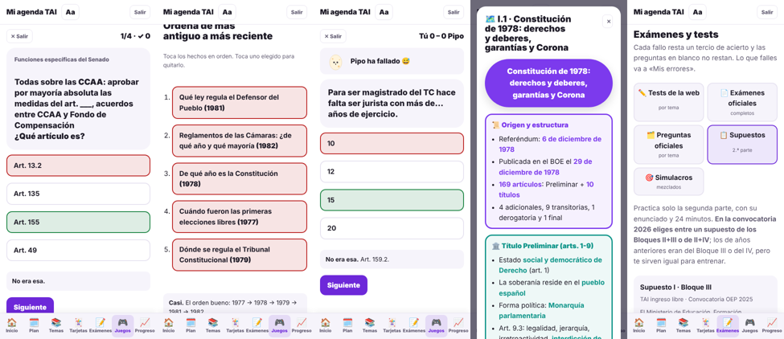

# 🐣 Mi agenda TAI

Web gratuita para preparar la oposición de **Técnico Auxiliar de Informática de la Administración del Estado (TAI)**, convocatoria 2026.
Organiza el estudio, te pone a prueba con exámenes oficiales y te mantiene motivada con Pipo, una mascota que crece con tu racha.

<p align="center"></p>

👉 **https://henar15.github.io/agenda-tai**

> Cada persona entra con su cuenta de Google y tiene su propio horario, progreso y racha. Sin cuenta solo se ve la portada y una demo.

---

## ✨ Qué tiene

| Sección | Para qué sirve |
|---|---|
| 🏠 **Inicio** | Pipo y tu racha, lo que toca hoy, cuenta atrás al examen, nota estimada, retos de la semana y resumen del día. |
| 🗓️ **Plan** | *Hoy* (lo que toca hoy y nada más: se fija por la mañana y lo vas tachando), *Semana*, *Mes* y tu *Horario* editable. Si te retrasas, lo pendiente se reparte en los días siguientes. |
| 📚 **Temas** | Los 34 temas por bloque, con tarjetas, test y **esquema visual** de cada tema, que se puede **imprimir** o guardar en PDF (uno por hoja A4). |
| 🧠 **A tu ritmo** | Repaso adaptativo: un modelo de memoria tipo FSRS decide qué preguntarte cada día según lo que fallas y **cómo de segura respondes**. Los errores cometidos con seguridad se destacan y vuelven al día siguiente (efecto de hipercorrección), lo fallado se repite en la misma sesión hasta acertarlo (reaprendizaje sucesivo) y lo que te costó aprender reaparece de vez en cuando. |
| 🃏 **Tarjetas por tema** | Tarjetas cortas y visuales para estudiar tema a tema. |
| 📝 **Exámenes** | Exámenes oficiales completos (2019–2025), preguntas oficiales por tema y bloque, tests de la web, **supuestos** (2.ª parte, primero los de tu supuesto: II+III o II+IV) y simulacros a medida. Con pistas, corrección al momento o al final, dudosas y penalización de −1/3. |
| 🎯 **Simulacro semanal** | Un examen completo como el real (80 preguntas + tu supuesto, 120 min) que cambia cada lunes y te dice si habrías pasado la **nota de corte** de convocatorias anteriores. |
| 🧭 **Lo que ya sé** | Indicas tus estudios previos (DAM, DAW, ASIR, SMR, grado) y haces un **test de nivel** general o por tema. Los temas que dominas pasan a repaso rápido en el plan. |
| 🎮 **Juegos** | Verdadero/falso, Empareja, Completa la frase, **¿Qué artículo es?**, **Ordena la línea temporal**, **Supervivencia** y **Duelo con Pipo**. |
| 📈 **Progreso** | **Puntos débiles** por tema, **historial** de racha y estadísticas, evolución de notas y logros. |
| 🍅 **Pomodoro** | Modo concentración a pantalla completa (– para minimizar, ✕ para parar). |

### 🐣 Pipo, la mascota

Empieza como huevo y va evolucionando hasta fénix según tu racha. Cada día tienes una meta pequeña de puntos (cada tarjeta clasificada o pregunta respondida suma). Hay **escudos** que protegen la racha (uno cada 7 días, máximo 2) y **días de descanso** que no la rompen. Los retos semanales dan premios para Pipo (bufanda, capa, aura).

### 📱 Como app en el móvil

La web se puede **instalar** (Android: botón «Instalar» en Inicio; iPhone: Compartir → «Añadir a pantalla de inicio») y funciona **sin conexión** con lo último que hayas cargado.

### ♿ Accesibilidad

Navegación con teclado y enlace «Saltar al contenido», etiquetas para lector de pantalla, avisos con `role=status`, botón **Aa** para agrandar el texto, contraste revisado y respeto a «reducir movimiento».

---

## 🗂️ Estructura del proyecto

```
agenda-tai/
├── index.html              Página única de la app
├── manifest.webmanifest    Datos para instalarla como app
├── sw.js                   Service worker (modo sin conexión)
├── assets/
│   ├── css/styles.css      Estilos (tema claro/oscuro, móvil y escritorio)
│   ├── icons/              Iconos de la app
│   └── js/                 Código, un archivo por funcionalidad
│       ├── firebase-config.js   Configuración pública de Firebase
│       ├── core.js              Estado, utilidades y guardado (local + Firestore)
│       ├── motivacion.js        Pipo, racha, logros y retos
│       ├── plan.js              Plan diario, horario y vista Plan
│       ├── tarjetas.js          Tarjetas y repaso espaciado
│       ├── pomodoro.js          Pomodoro y modo concentración
│       ├── progreso.js          Estadísticas, puntos débiles e historial
│       ├── inicio.js            Pantalla de inicio
│       ├── temario.js           Temario y esquemas visuales
│       ├── tests.js             Tests por tema
│       ├── examenes.js          Exámenes oficiales, simulacros y supuestos
│       ├── juegos.js            Juegos
│       ├── nivel.js             Test de nivel «Lo que ya sé»
│       ├── semanal.js           Simulacro semanal y notas de corte
│       ├── ritmo.js             «A tu ritmo»: modelo de memoria y sesiones adaptativas
│       ├── render.js            Navegación y pintado de vistas
│       ├── acciones.js          Clics y teclado
│       └── main.js              Arranque de la app
├── data/                   Contenido en JSON (ver docs/DATOS.md)
│   ├── temas.json          Los 34 temas
│   ├── plan.json           Plan de 26 semanas
│   ├── temas/              Tarjetas, preguntas y esquema de cada tema
│   ├── examenes/           Exámenes oficiales del INAP
│   └── privado/            Material cifrado
├── firebase/
│   └── firestore.rules     Reglas de seguridad de la base de datos
└── docs/                   Documentación y capturas
```

Es una web estática (GitHub Pages) **sin compilación ni dependencias**: HTML, CSS y JavaScript. Los scripts se cargan en orden desde `index.html` y comparten el estado global `S` (datos) y `ui` (estado de la pantalla).

## 🔐 Datos y privacidad

- El inicio de sesión es **solo con Google** (Firebase Authentication).
- El progreso se guarda en **Firestore**, en `users/{uid}` y `users/{uid}/kv/{clave}`. Las reglas (`firebase/firestore.rules`) solo permiten a cada persona leer y escribir **sus propios datos**.
- También se guarda una copia en el navegador para que funcione sin conexión.
- En este repositorio **no hay datos personales** ni material de academias. Los tests compartidos en grupos privados están **cifrados** (AES-GCM) y solo se descifran con una clave guardada en la cuenta de quien tiene acceso.

## 🛠️ Montarla tú

1. Haz un fork y activa **GitHub Pages** (rama `main`, carpeta raíz).
2. Crea un proyecto en [Firebase](https://console.firebase.google.com): activa **Authentication → Google** y **Firestore**.
3. Copia la configuración web en `assets/js/firebase-config.js` y añade tu dominio `*.github.io` en *Authentication → Dominios autorizados*.
4. Pega `firebase/firestore.rules` en *Firestore → Reglas* y publica.
5. Para probar en local: `python3 -m http.server` y abre `http://localhost:8000`.

Al publicar cambios, sube la versión (`data-v` y `?v=` en `index.html`, `const V` en `assets/js/main.js` y `VERSION` en `sw.js`) para que los navegadores no se queden con la versión antigua. El código se formatea con [Prettier](https://prettier.io) (`npx prettier --write .`).

## ➕ Añadir contenido

El formato de cada archivo de `data/` (tarjetas, preguntas, esquemas y exámenes) está explicado en [docs/DATOS.md](docs/DATOS.md).

---

Hecho con cariño para opositar con menos agobio. 💜
